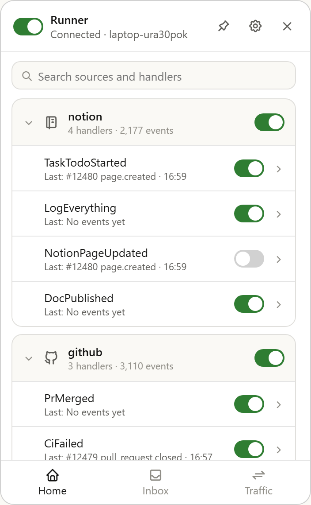
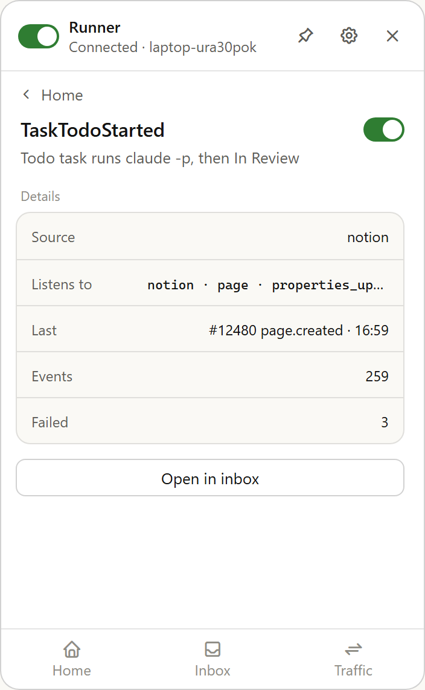
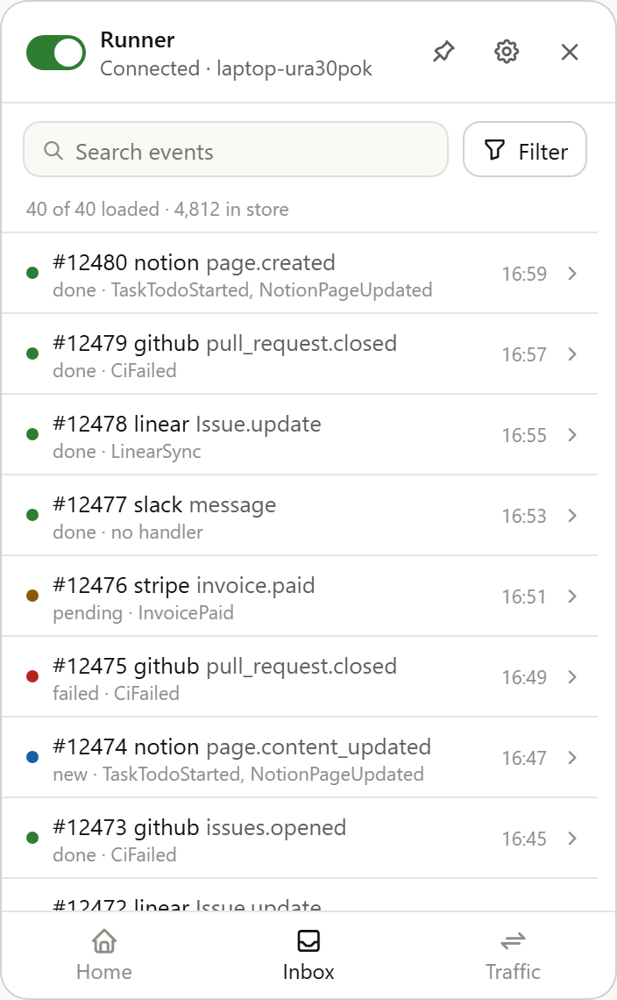
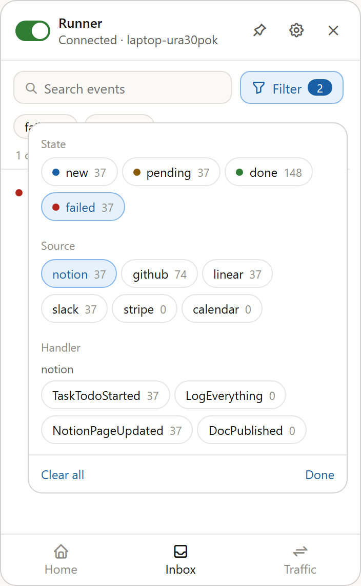
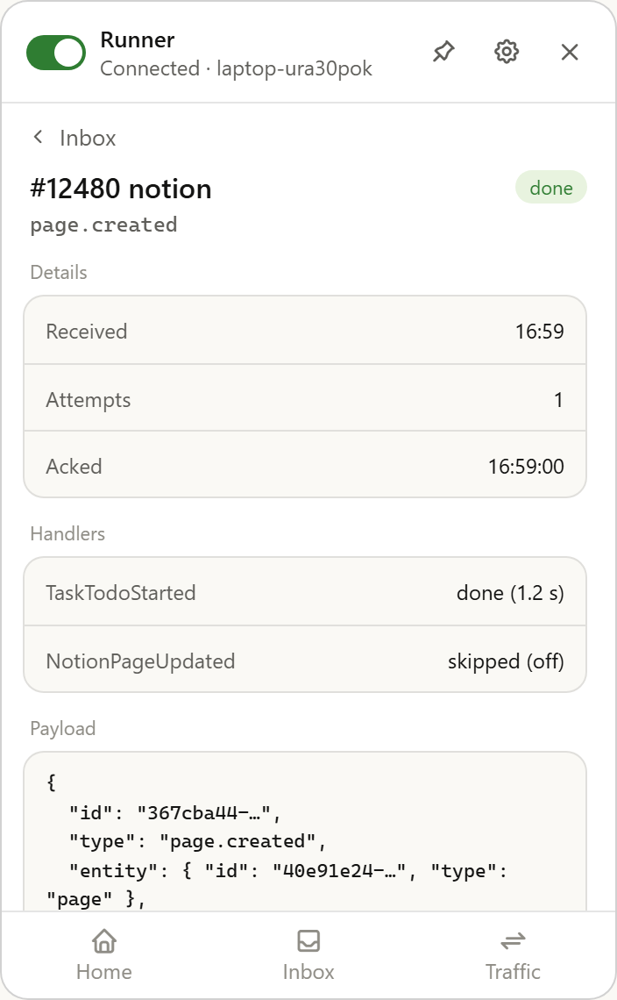
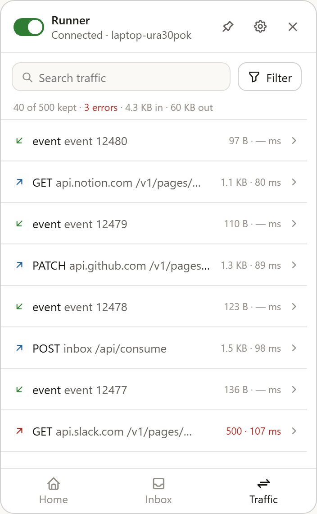
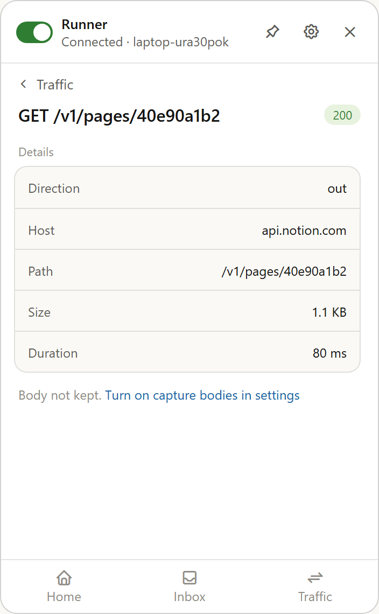
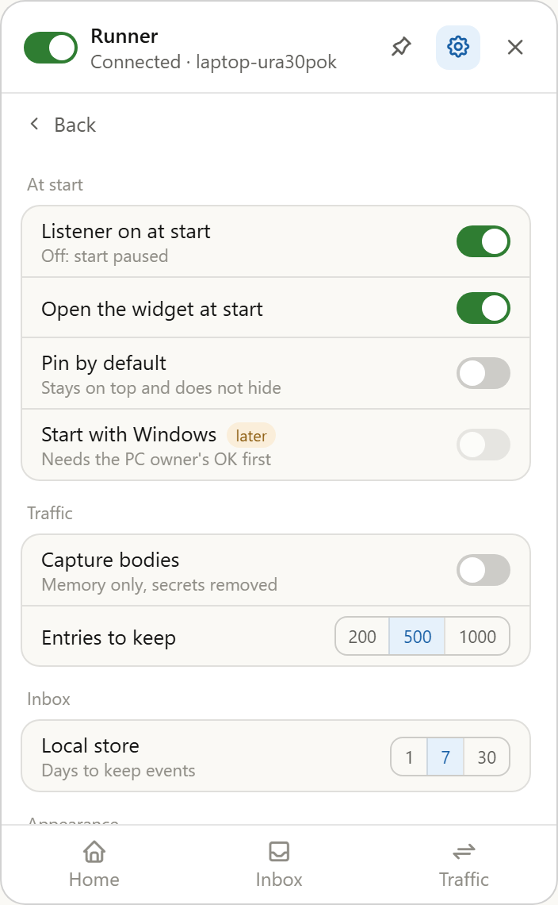
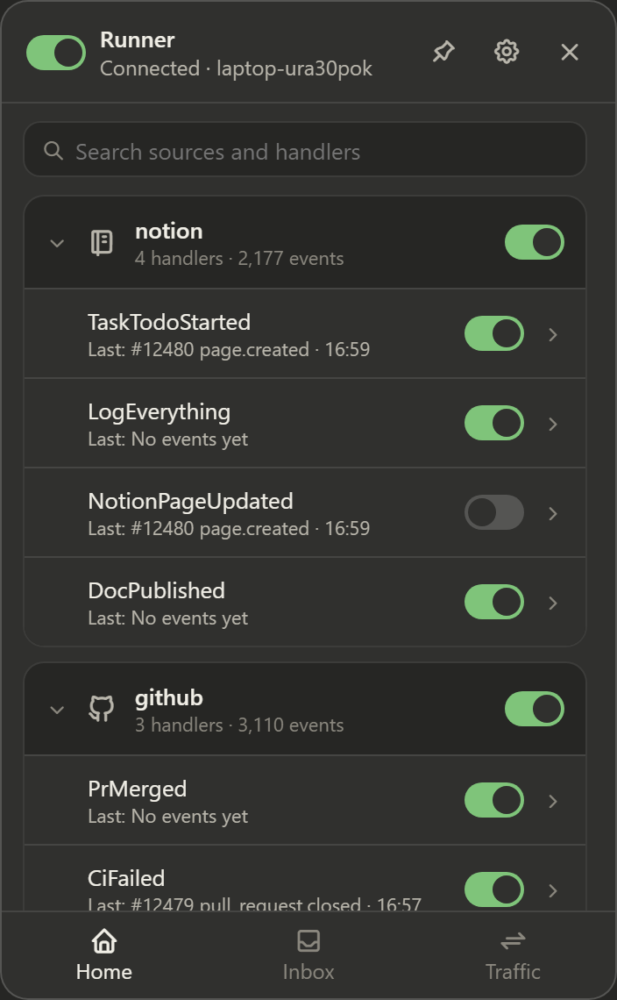

# Tray widget

The tray widget is the visible control panel of the local runner. It shows the listener, the sources, the handlers, the stored events and the network traffic, and it lets the user turn each one on or off. It is an HTML page in WebView2 inside the `Runner.Tray` process, and the runner runs in the same process.



## 1. Properties

| Property | Value |
|---|---|
| ID | SPEC-TRAY-1 |
| Name | Runner Tray (working name, open question 8) |
| Project | Runner |
| Kind | Desktop tray app with a widget window |
| Status | Draft, ready for review |
| Version | 0.2 (design version 9) |
| Owner | MgCohen |
| Usage scope | Personal. One user, one PC, one consumer of the inbox. |
| Platforms | Windows 11 (x64). Other platforms are not in scope. |
| Stack | .NET 10, WinForms shell, WebView2, HTML + CSS + plain JavaScript, SQLite |
| Repository | `MgCohen/runner`, project `src/Runner.Tray` (private) |
| Install location | `%LOCALAPPDATA%\Runner` (app, store, settings, logs) |
| Start | `tray.ps1` in a visible terminal, by the user |
| Mockup | [tray-widget-mockup.html](tray-widget-mockup.html) (open it in a browser) |
| Related | [CONTRACTS.md](../../CONTRACTS.md), [src/Runner.Tray/README.md](../../src/Runner.Tray/README.md), `MgCohen/inbox` |

## 2. Capabilities

| ID | Capability | What the user can do | Now or later |
|---|---|---|---|
| C1 | Listener control | Turn the inbox connection on or off, and see its state | Now |
| C2 | Sources and handlers | See each source with its handlers, and turn each one on or off | Now |
| C3 | Handler detail | See what one handler listens to, and its recent results | Now |
| C4 | Inbox | Search and filter the stored events, and open one event | Now |
| C5 | Traffic | Search and filter the calls and socket messages, and open one entry | Now |
| C6 | Settings | Change the start, traffic, inbox and appearance settings | Now |
| C7 | Window | Open from the tray, move, pin on top, hide | Now |
| C8 | Theme | Use the system, light or dark theme, or a new theme file | Now |
| C9 | Mock mode and self-test | Run the app with no network and no Claude, and save screenshots of each page | Now |
| C10 | Start with Windows | Start the app at log-on | Later |
| C11 | Failure notification | Get a Windows notification when a handler fails | Later |

## 3. Requirements

### 3.1 Product

| ID | Requirement |
|---|---|
| P1 | The user sees the listener state on every page, and can change it with one click. |
| P2 | Each source and each handler has its own switch. A change applies at once. |
| P3 | A new source or a new handler shows in the widget with no change to the UI code. |
| P4 | The user can find any stored event by text, state, source or handler. |
| P5 | The user can see each network call and socket message, with its size, duration and result. |
| P6 | Each list item opens a detail page. Each detail page has a link back. |
| P7 | The widget opens with the listener as saved, or paused with `--paused`. Opening the widget does not start work by itself. |

### 3.2 Usage

| ID | Requirement |
|---|---|
| U1 | One user on one PC. There is no sign-in and no multi-user state. |
| U2 | The user starts the app in a visible terminal. The app runs while the terminal is open. |
| U3 | The widget is a small window near the tray. It stays open until the user hides it. |
| U4 | The widget works with no network. It then shows the listener as "Error" or "Paused". |

### 3.3 Technical

The PC has a CrowdStrike sensor that the PC owner manages. The owner approved a visible app that the user starts. Rules T1 to T3 keep the app inside that approval.

| ID | Requirement | Reason |
|---|---|---|
| T1 | The runner runs in the `Runner.Tray` process. The app starts no other runner process. | A hidden runner process was the chain that the sensor stopped |
| T2 | No hidden windows, no `-ExecutionPolicy Bypass`, no restart loop, no start at log-on | Same reason |
| T3 | `claude -p` is the only child process. Do not set `CreateNoWindow` on it. | Same reason |
| T4 | The UI files are local files of the app. The page loads nothing from the network. | The widget must work offline |
| T5 | Traffic never keeps headers, tokens or query strings. Bodies are kept only in memory, only when "Capture bodies" is on, with secrets removed. | Headers hold tokens, and bodies can hold page content |
| T6 | In mock mode, no network call leaves the PC and no `claude` process starts. | Tests must be safe to run at any time |
| T7 | Secrets come from 1Password through `op run`. No secret is in git, in settings or in the UI. | Repository rule |
| T8 | Lists load in pages of 50 items. The traffic log has a fixed capacity. | The UI stays fast when the store has many events |
| T9 | `dotnet build` and `dotnet test` pass, and the self-test passes in mock mode. | Repository rule |

## 4. Architecture

### 4.1 Principles

1. **Modular.** Each module has one job and a public contract. A module does not read the internal state of another module.
2. **Open for extension.** A new source, handler, page, setting or theme is a new unit. It does not change the code of other units.
3. **The host owns the state.** The page shows the state and sends commands. The page saves nothing.
4. **The theme is decoupled.** Components use only design tokens. A theme is one CSS file of tokens, and a change of theme changes nothing else.
5. **Contract first.** The UI and the runner meet only through the message contract (section 6.2). The runner and the handlers meet only through `Runner.Abstractions`.
6. **Mock first.** Each external dependency (inbox, Notion, Claude) has a replacement for mock mode, and the self-test uses it.

### 4.2 Modules

```
Runner.Tray (process)
├── Shell            window, tray icon, tray menu, WebView2, bridge
├── UI (web files)
│   ├── app          router, state store, command sender
│   ├── pages/       home, handler, inbox, event, traffic, entry, settings
│   ├── components/  switch, chip, filter panel, list row, detail row, badge …
│   └── themes/      default.css (tokens), more theme files
├── Runner.Host      listener, store, dispatcher, traffic log, switches
├── Runner.Handlers  business logic, found through [On] attributes
└── Runner.Abstractions  contracts between host and handlers
```

| Module | Owns | Depends on | Changes when |
|---|---|---|---|
| Shell | Window, tray icon, bridge | Runner.Host, UI files | Window behavior changes |
| UI app | Routes, the last `state` message, commands | Bridge contract | Navigation changes |
| UI page | One page: render and actions | UI app, components | That page changes |
| UI component | One control and its states | Tokens | That control changes |
| Theme file | Token values | Nothing | The look changes |
| Runner.Host | Listener, store, dispatch, traffic, switches | Runner.Abstractions | The connector changes |
| Runner.Handlers | Handler logic | Runner.Abstractions | A handler changes |

### 4.3 Extension points

| To add | Do this | No change to |
|---|---|---|
| A source | Add it in the inbox Worker. The widget reads the source list from the inbox. | UI, Shell |
| A handler | Add a class with `[On(source, type, action)]` in `Runner.Handlers` | UI, Shell, Runner.Host |
| A page | Add a file in `pages/` and register its route | Other pages |
| A setting | Add a key to the settings schema (section 6.3). The Settings page shows it from the schema. | Other settings |
| A theme | Add a token file in `themes/` | Components, pages |
| A source icon | Add a name-to-icon entry. Unknown sources get a default icon. | Pages |

### 4.4 Patterns

| Pattern | Where | Use |
|---|---|---|
| State snapshot + commands | Bridge | The host sends `state`; the page sends commands; the host sends the new `state` |
| Attribute discovery | Handlers | `HandlerCatalog` finds handlers through `[On]` |
| Dependency injection with replacements | Host, mock mode | Mock mode replaces the HTTP handlers and `IClaudePrint` |
| Ring buffer | Traffic log | Fixed capacity, the oldest entry goes first |
| Design tokens | UI | Each color, radius, space and font size is a CSS variable |
| Page registry | UI app | Route name → page module |
| Schema-driven form | Settings page | The page renders the settings from their schema |

### 4.5 Decisions

| Decision | Reason |
|---|---|
| The runner runs in the tray process | The approved setup is one visible process that the user starts |
| The UI is HTML in WebView2, not WinForms controls | The mockup is the UI, and HTML makes the theme and the layout easy to change |
| Plain JavaScript with no framework and no build step | The UI is small, and the files load offline with no tool chain |
| Handler off = the event is skipped and acked | A handler that is off must not block other handlers |
| Source off or listener off = events wait | The user pauses a source, and the events run later |
| Mock mode in the same app, with `--mock` | The self-test and the demos use the real UI and the real dispatcher |

## 5. Product definition

### 5.1 Window

| Item | Behavior |
|---|---|
| Size | 350 × 560 logical pixels, fixed. It scales with the display (DPI). |
| Shape | No title bar, rounded corners, a thin border |
| Open | A left click on the tray icon opens the widget, or hides it if it is open |
| Hide | The ✕ button hides it. A click outside the widget does **not** hide it. |
| Move | Drag the header. The switch and the buttons in the header do not start a drag. |
| Pin | The pin button sets "always on top". When on, the button has the accent color. |
| Position | Bottom right of the work area at the first open. After a drag, the app keeps the position until it exits. |
| Tray icon | Shows the listener state: green (connected), amber (connecting), gray (paused), red (error) |
| Tray menu | Right click: Show · Listener on/off · (mock mode: Send mock task event, Send mock GitHub event) · Exit |
| Exit | Stops the runner, then closes the app |

The widget has a header, one page area that scrolls, and a bottom bar with Home, Inbox and Traffic.

### 5.2 Pages

Each page has the same fields: **Purpose · Entry · Layout · Actions · Empty states · Data**.

<details>
<summary>Header · on every page</summary>

- **Purpose:** the main state and the main controls.
- **Layout, left to right:** listener switch, title "Runner", subtitle, pin, settings, hide (✕).
- **Subtitle:** "Connected · {consumer}", "Connecting…", "Paused" or "Error: {short reason}".
- **Actions:**
  - **Listener switch:** sets the listener on or off.
  - **Pin:** sets "always on top".
  - **Settings:** opens Settings. On the Settings page, a second click returns to the page before.
  - **✕:** hides the widget.
- **Data:** the listener state, the consumer name.
</details>

<details>
<summary>Home · sources and their handlers (C2)</summary>


- **Purpose:** see and switch each source and each handler.
- **Entry:** bottom bar "Home". It is the start page.
- **Layout:**
  1. Search field "Search sources and handlers".
  2. One foldable card for each source, in the order of the inbox source list.
- **Source card:**
  - **Header:** chevron, icon, name, "{n} handlers · {n} events", the source switch.
  - **Body:** one row for each handler: name, "Last: #{id} {type} · {time}", the handler switch, a chevron.
- **Fold state:** sources that have handlers are unfolded at the first open. The app keeps the fold state until it exits.
- **A handler with two or more sources** shows under each of them, with the same switch.
- **Actions:**
  - **Card header:** folds or unfolds the card.
  - **Source switch:** sets the source on or off.
  - **Handler row:** opens the handler detail page.
  - **Handler switch:** sets the handler on or off.
  - **Search:** shows only the matching sources and handlers, unfolded.
- **Empty states:** "No handlers yet" for a source with no handlers. "No sources or handlers match" for a search with no match.
- **Data:** the source list from the inbox, the handlers from `HandlerCatalog`, the counts and the last event from the local store.
</details>

<details>
<summary>Handler detail (C3)</summary>



- **Purpose:** what one handler does, and its recent result.
- **Entry:** a handler row on Home.
- **Layout:** "‹ Home", the name and the switch, a one-line description, a **Details** group (Source · Listens to · Last · Events · Failed), the button "Open in inbox".
- **Actions:**
  - **Switch:** as on Home.
  - **"Open in inbox":** opens the Inbox with the filter "Handler = this handler".
- **Data:**
  - **Description:** handlers have no description in the code yet (open question 2). Until then, the line shows the `[On]` values in words, for example "Runs on notion page events".
  - **Listens to:** the `[On]` values (source · type · action).
  - **Counts:** from the local store.
</details>

<details>
<summary>Inbox · events in the local store (C4)</summary>





- **Purpose:** see every event that the runner has: new, pending, done and failed.
- **Entry:** bottom bar "Inbox", or "Open in inbox" on a handler page.
- **Layout:**
  1. Search field "Search events" and the **Filter** button.
  2. Active filters as chips, each with ×.
  3. Summary line "{shown} of {loaded} loaded · {total} in store".
  4. Event rows, newest first.
  5. "Load older events" at the end.
- **Event row:** state dot, "#{id} {source} {type}", "{state} · {handlers}", the time, a chevron.
- **Filter panel:**
  - **State:** new · pending · done · failed, each with its colored dot.
  - **Source:** each source.
  - **Handler:** grouped under the source name. If sources are selected, it shows only their handlers.
  - Each group allows two or more values. Each chip shows its count with the other active filters.
  - **Footer:** "Clear all" · "Done". The footer stays visible when the panel scrolls.
- **Actions:**
  - **Row:** opens the event detail page.
  - **Filter:** opens or closes the panel.
  - **Chip ×:** removes that filter.
  - **"Load older events":** loads the next 50 events.
- **Empty states:** "No events yet" for an empty store. "No events match these filters" for no match.
- **Data:** the local store, 50 events for each load.
</details>

<details>
<summary>Event detail (C4)</summary>



- **Purpose:** everything that the store has about one event.
- **Entry:** an Inbox row, or "Open event #… in inbox" on a traffic detail page.
- **Layout:** "‹ Inbox", "#{id} {source}" and the state badge, the event type, a **Details** group (Received · Attempts · Acked), a **Handlers** group (one row for each handler, with its result), a **Payload** group (the JSON, formatted).
- **Handler results:** "done ({duration})", "failed: {error}", "skipped (off)" or "waiting".
- **Rows:** long values are cut with "…", and the full value shows on hover.
- **Data:** `StoredEvent` (section 6.1).
</details>

<details>
<summary>Traffic · calls and socket messages (C5)</summary>



- **Purpose:** see what the runner sends and receives.
- **Entry:** bottom bar "Traffic".
- **Layout:**
  1. Search field "Search traffic" and the **Filter** button.
  2. Active filter chips.
  3. Summary line "{shown} of {kept} kept · {n} errors · {n} KB in · {n} KB out". The error part is red when it is more than 0.
  4. Entry rows, newest first.
- **Entry row:** direction arrow, "{kind} {target}", "{size} · {ms} ms", or "{status} · {ms} ms" in red for an error.
- **Filter groups:** Direction (in, out) · Kind (event, hello, connect, GET, POST, PATCH and others that occur) · Result (ok, error).
- **Actions:** a row opens the traffic detail page. The filter and the chips work as on the Inbox.
- **Empty state:** "No traffic matches these filters".
- **Data:** `TrafficLog`, with the capacity from the setting "Entries to keep".
</details>

<details>
<summary>Traffic detail (C5)</summary>



- **Layout:** "‹ Traffic", "{kind} {target}" and the status badge, a **Details** group (Direction · Host · Path · Size · Duration).
- **Socket event:** the button "Open event #{id} in inbox".
- **HTTP call, capture bodies on:** a **Response body** group with the kept body.
- **HTTP call, capture bodies off:** "Body not kept. Turn on capture bodies in settings", with a link to Settings.
</details>

<details>
<summary>Settings (C6)</summary>



- **Entry:** the settings button in the header.
- **Layout:** "‹ Back", then the groups At start · Traffic · Inbox · Appearance · About (section 6.3).
- **Back** returns to the page that was open before.
- **Controls:** switches for on/off settings, segmented controls for choices, plain text for read-only values, disabled switches with a "later" tag for future settings.
- **A change applies at once,** and the app saves it in the settings file.
</details>

## 6. Technical definition

### 6.1 Data model

| UI value | Source in the code | Notes |
|---|---|---|
| Listener state | `SocketListener.State` | Paused, Connecting, Connected, Error |
| Switches | `RunnerSwitches` (`switches.json`) | Listener, each source, each handler |
| Source list | `GET /` of the inbox, plus `RunnerSwitches.KnownSources` | The inbox answers `{"sources": […]}` |
| Handler list | `HandlerCatalog`, the `[On]` attributes | Key = class name |
| Event | `StoredEvent`: `Event`, `Status`, `Attempts`, `LastError`, `NextRetryAt`, `DoneHandlers`, `AckedAt` | Payload = `Event.Payload` |
| Event state in the UI | new = Pending, 0 attempts · pending = Pending, 1 or more attempts, or waiting for a source · done = Done · failed = Failed | |
| Handler result | done = in `DoneHandlers` · skipped = handler off when it ran · failed = `LastError` · waiting = not run yet | "skipped" needs a record in the store (open question 3) |
| Traffic entry | `TrafficEntry`: `Time`, `Direction`, `Kind`, `Target`, `Status`, `Size`, `Duration` | Socket entries link to an event ID |

### 6.2 UI ↔ runner contract

The page and the C# host exchange JSON messages through WebView2 (`postMessage` and `WebMessageReceived`). The host owns all state and sends `state` after each command.

**Host to page:**

| Message | When | Content |
|---|---|---|
| `state` | At start, and at each change | Listener state, consumer, switches, sources, handlers with counts and last event, settings and their schema |
| `events` | Answer to `loadEvents` | The page of events, `total`, `hasMore` |
| `event` | Answer to `getEvent` | One full event |
| `traffic` | Answer to `loadTraffic`, and each new entry | Entries, `kept`, the totals |
| `trafficEntry` | Answer to `getTraffic` | One entry, with the body if one was kept |

**Page to host:**

| Command | Fields |
|---|---|
| `setListener` | `on` |
| `setSource` | `name`, `on` |
| `setHandler` | `name`, `on` |
| `setPin` | `on` |
| `hide` | none |
| `dragStart` | none (the host starts a window drag) |
| `loadEvents` | `filter` {`states`, `sources`, `handlers`, `text`}, `before` (event ID), `limit` |
| `getEvent` | `id` |
| `loadTraffic` | `filter` {`directions`, `kinds`, `results`, `text`} |
| `getTraffic` | `index` |
| `setSetting` | `key`, `value` |

### 6.3 Settings

File: `%LOCALAPPDATA%\Runner\settings.json` (mock mode: `%LOCALAPPDATA%\Runner\mock\settings.json`). Each row is one entry of the settings schema.

| Key | Group | Type | Default | Effect | Now or later |
|---|---|---|---|---|---|
| `listenerOnStart` | At start | bool | true | Off: the app starts paused. `--paused` overrides it. | Now |
| `openOnStart` | At start | bool | true | Opens the widget at start | Now |
| `pinOnStart` | At start | bool | false | Starts pinned | Now |
| `startWithWindows` | At start | bool | false | Disabled. Needs the PC owner's OK first. | Later |
| `captureBodies` | Traffic | bool | false | Keeps request and response bodies in memory, max 16 KB each, secrets removed | Now |
| `trafficKeep` | Traffic | 200 · 500 · 1000 | 500 | Capacity of the traffic log | Now |
| `storeDays` | Inbox | 1 · 7 · 30 | 7 | The local store deletes events that are older | Now |
| `theme` | Appearance | System · Light · Dark · {theme files} | System | Color theme | Now |
| `notifyOnFailure` | Appearance | bool | false | Disabled. A Windows notification when a handler fails. | Later |

- **About group (read-only):** consumer, inbox URL, store folder, version.
- **Secret removal for "Capture bodies":** replace the value of each JSON key that contains `token`, `secret`, `password`, `authorization` or `key` (any case) with `"•••"`.

## 7. Visual definition

### 7.1 Theme system

| Rule | Detail |
|---|---|
| Tokens only | Components and pages use only `var(--token)`. No color, radius, space or font size is written in a component. |
| One file for each theme | `themes/{name}.css` sets all tokens. `default.css` has the light and dark values. |
| Theme change | The app sets `data-theme` on the page root, or loads another theme file. Nothing else changes. |
| Fallback | A theme file that does not set a token gets the value from `default.css`. |
| Check | A self-test step loads each theme file and saves a screenshot of each page. |



### 7.2 Tokens

| Token | Light | Dark | Use |
|---|---|---|---|
| `surface-0` | #f5f4ef | #1f1e1d | Behind the widget |
| `surface-1` | #faf9f5 | #262624 | Cards, groups, hover |
| `surface-2` | #ffffff | #30302e | Widget background |
| `text-primary / secondary / muted` | #141413 / #5e5d59 / #8f8d86 | #f0eee6 / #b8b5ab / #8a877e | Text |
| `accent / success / warning / danger` | #185fa5 / #2f7d32 / #8a5a0b / #b3261e | #85b7eb / #7fc47a / #ef9f27 / #f09595 | States |
| `border / border-strong` | black 10% / 18% | white 10% / 18% | Hairlines, 0.5 px |
| `radius-window / card / control` | 16 / 12 / 8 | same | Corners. Chips and badges are pill-shaped. |
| `font-sans / font-mono` | system UI / Cascadia Mono | same | Text and code |
| `font-body / small / title` | 13 / 11 / 16 px | same | Weights 400 and 500 only |

### 7.3 Components

| Component | States | Notes |
|---|---|---|
| Switch | off, on, disabled | 34 × 20, round knob |
| Icon button | normal, hover, on (accent) | 28 × 28 |
| Search field | empty, typing | Height 32, the same height as the Filter button |
| Filter button | normal, active (accent), with count | Opens the filter panel |
| Filter panel | closed, open, scrolling | Max height 420. The footer stays visible. |
| Chip | off, on (accent) | Label and count |
| Active-filter chip | normal | Label and × |
| Card / group | normal | Surface 1, thin border |
| List row | normal, hover | Fixed height 46 |
| Detail row | normal, hover | Min height 38, label left, value right |
| Badge | done, pending, new, failed, ok, error | Tint background, text in the same hue |
| Segmented control | one option on | For choices such as Theme |

### 7.4 Layout rules

- **Scroll bar:** thin. The page always keeps its gutter (`scrollbar-gutter: stable`), so the content never moves.
- **Icons:** Tabler outline icons, bundled with the app as local files (open question 6).

## 8. Acceptance tests

Each test maps to a `--selftest` check, and each check saves a screenshot. Mock tests run with `tray.ps1 -Mock -SelfTest`. Real tests run with `tray.ps1 -SelfTest`, with the Claude handlers off.

| # | Given | When | Then | Mode |
|---|---|---|---|---|
| A1 | The app starts with `--paused` | The widget opens | The listener switch is off, the subtitle says "Paused", and no event runs | Mock |
| A2 | The listener is off, and a task event is in the store | The listener turns on | The task runs to In Review, and the Inbox shows it as done | Mock |
| A3 | A handler is off | An event for it arrives | The event is done, and its detail shows "skipped (off)" for that handler | Mock |
| A4 | A source is off | An event of that source arrives | The event stays pending. When the source turns on, it runs. | Mock |
| A5 | Home has 6 sources | The user searches "pr" | Only the matching handlers and sources show, unfolded | Mock |
| A6 | The Inbox has events | The user selects State = failed and Source = notion | Only failed Notion events show, and two chips show | Mock |
| A7 | The filter panel is open with all groups | Its content is taller than 420 | It scrolls, and "Clear all" and "Done" stay visible | Mock |
| A8 | A handler detail page | The user clicks "Open in inbox" | The Inbox opens with the filter "Handler = that handler" | Mock |
| A9 | The Traffic page | The user selects Result = error | Only errors show, and the summary line counts them in red | Mock |
| A10 | "Capture bodies" is off | The user opens an HTTP traffic entry | It says "Body not kept" with a link to Settings | Mock |
| A11 | Any page with a scroll bar | The content grows from short to long | No element moves sideways | Mock |
| A12 | The widget is open | The user clicks outside it | It stays open | Mock |
| A13 | Pin is on | Another window gets the focus | The widget stays on top | Mock |
| A14 | The real inbox | The listener turns on | The subtitle shows "Connected", and Traffic shows `connect` and `hello` | Real |
| A15 | Mock mode | Any test | The traffic log has no host outside `*.mock.invalid`, and no `claude` process starts | Mock |
| A16 | A second theme file | The user selects it | Each page uses its tokens, and no component keeps a color of the old theme | Mock |
| A17 | A new handler class with `[On]` | The app starts | Home shows it under its source, with no UI change | Mock |

## 9. Non-goals

| Non-goal | Reason |
|---|---|
| A remote or web version of the widget | The runner is local, and the approval covers a local visible app |
| Edit or replay of events | The inbox is the record of events. A replay needs its own design. |
| Changes to the inbox Worker | The widget uses the inbox API as it is |
| Other platforms than Windows | The only PC is Windows, and WebView2 is a Windows control |
| A UI framework or a build step | The UI is small, and plain files load offline |

## 10. Open questions

1. **Code interface:** review the handler definition (`[On]`, `IEventHandler`, contracts) before the widget depends on more of it.
2. **Handler description and metadata:** does a handler get a `Description` property or an attribute, and what custom metadata can a handler give to its detail page?
3. **"Skipped" in the store:** the store does not record that a handler was skipped. Add a record, or compute it from the switch history?
4. **Counts:** do the source and handler counts cover all time, the retention period, or today?
5. **Sources with no handlers:** show them, or show only sources that have handlers?
6. **Icons:** bundle the Tabler font, or a small set of SVG icons?
7. **Window position:** keep it after an exit (in the settings file), or reset it at each start?
8. **Name:** the names of the project (Runner) and the app (Runner Tray) are working names.
