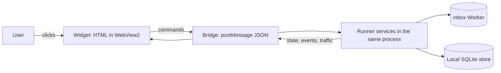

# Tray widget

| Field | Value |
|---|---|
| ID | SPEC-TRAY-1 |
| Status | Draft, ready for review |
| Version | 0.1 (design version 9) |
| Owner | MgCohen |
| Date | 2026-11-04 |
| Repository | `MgCohen/runner`, project `src/Runner.Tray` |
| Mockup | [tray-widget-mockup.html](tray-widget-mockup.html), open it in a browser |
| Related | [CONTRACTS.md](../../CONTRACTS.md), [src/Runner.Tray/README.md](../../src/Runner.Tray/README.md) |

## 1. Summary

The tray widget is the visible control panel of the local runner. It shows the listener, the sources and their handlers, the events in the local store, and the network traffic, and it lets the user turn each part on or off. The widget is an HTML page in WebView2, inside the `Runner.Tray` process, and it looks and behaves like the mockup.



## 2. Scope

| In scope | Out of scope |
|---|---|
| Window, tray icon and tray menu | Start with Windows (shown as "later", disabled) |
| Pages: Home, handler detail, Inbox, event detail, Traffic, traffic detail, Settings | Notifications on failed handlers (shown as "later", disabled) |
| Switches: listener, sources, handlers | Custom metadata for each handler |
| Search and filters on Inbox and Traffic | Edit or replay of events |
| Settings file with the settings in section 9 | A remote or web version of the widget |
| `--mock` and `--selftest` support for the new UI | Changes to the inbox Worker |

## 3. Constraints

The PC has a CrowdStrike sensor that the PC owner manages. The owner approved a visible app that the user starts. These rules keep the design inside that approval.

| Rule | Reason |
|---|---|
| The runner runs in the `Runner.Tray` process. The widget starts no other runner process. | A separate hidden runner process was the chain that the sensor stopped |
| No hidden windows, no `-ExecutionPolicy Bypass`, no restart loop, no start at log-on | Same reason |
| `claude -p` is the only child process. Do not set `CreateNoWindow` on it. | Same reason |
| The UI files are local files of the app. The page loads nothing from the network. | The widget must work offline, and the mockup's CDN icon font is not allowed in the app |
| Traffic never keeps headers, tokens or query strings. Bodies are kept only if "Capture bodies" is on, only in memory, with secrets removed. | Headers hold tokens. Bodies can hold page content. |
| In `--mock` mode, no network call leaves the PC and no `claude` process starts | Tests must be safe to run at any time |

## 4. Window behavior

| Item | Behavior |
|---|---|
| Size | 350 × 560 logical pixels, fixed. It scales with the display (DPI). |
| Shape | No title bar, rounded corners (radius 16), a thin border |
| Open | A left click on the tray icon opens the widget, or hides it if it is open |
| Hide | The ✕ button hides it. A click outside the widget does **not** hide it. |
| Move | Drag the header. The switch and the buttons in the header do not start a drag. |
| Pin | The pin button sets "always on top". When on, the button has the accent color. |
| Position | Bottom right of the work area at the first open. After a drag, the app keeps the position until it exits. |
| Theme | System, light or dark, from the Theme setting |
| Tray icon | Shows the listener state: green (connected), amber (connecting), gray (paused), red (error) |
| Tray menu | Right click: Show · Listener on/off · (mock mode: Send mock task event, Send mock GitHub event) · Exit |
| Exit | Stops the runner, then closes the app |

## 5. Pages

The widget has a header, one page area that scrolls, and a bottom bar.

```
┌ [listener switch] Runner          [pin] [settings] [✕] ┐   header
│  Connected · laptop-ura30pok                            │
├─────────────────────────────────────────────────────────┤
│  page area (scrolls; room for the scroll bar is always   │
│  kept, so the content never moves)                       │
├─────────────────────────────────────────────────────────┤
│        Home            Inbox            Traffic          │   bottom bar
└─────────────────────────────────────────────────────────┘
```

Each page block below has the same fields: **Purpose · Entry · Layout · Actions · Empty and error states · Data**.

<details>
<summary>Header · on every page</summary>

- **Purpose:** the main state and the main controls.
- **Layout, left to right:**
  1. Listener switch.
  2. Title "Runner".
  3. Subtitle: "Connected · {consumer}", "Connecting…", "Paused" or "Error: {short reason}".
  4. Pin button.
  5. Settings button.
  6. Hide button (✕).
- **Actions:**
  - **Listener switch:** sets `RunnerSwitches.Listener`.
  - **Pin:** sets "always on top".
  - **Settings:** opens Settings. On the Settings page, a second click returns to the page before.
  - **✕:** hides the widget.
- **Data:** the listener state (`SocketListener.State`), the consumer name.
</details>

<details>
<summary>Home · sources and their handlers</summary>

- **Purpose:** see and switch each source and each handler.
- **Entry:** bottom bar "Home". It is the start page.
- **Layout:**
  1. Search field "Search sources and handlers".
  2. One foldable card for each source, in the order of the inbox source list.
- **Source card:**
  - **Header:** chevron, icon, name, "{n} handlers · {n} events", and the source switch.
  - **Body:** one row for each handler: name, "Last: #{id} {type} · {time}", the handler switch, and a chevron.
- **Fold state:** the sources that have handlers are unfolded at the first open. The app keeps the fold state until it exits.
- **A handler with two or more sources** shows under each of them, with the same switch.
- **Actions:**
  - **Card header:** folds or unfolds the card.
  - **Source switch:** sets `RunnerSwitches.Sources[name]`.
  - **Handler row:** opens the handler detail page.
  - **Handler switch:** sets `RunnerSwitches.Handlers[name]`.
  - **Search:** shows only the matching sources and handlers, and unfolds them.
- **Empty and error states:**
  - **A source with no handlers:** "No handlers yet".
  - **No search match:** "No sources or handlers match".
- **Data:**
  - the sources from the inbox (`GET /`) and the known source list,
  - the handlers from `HandlerCatalog` and their `[On]` attributes,
  - the counts and the last event from the local store.
</details>

<details>
<summary>Handler detail</summary>

- **Purpose:** what one handler does, and its recent result.
- **Entry:** a handler row on Home.
- **Layout:**
  1. "‹ Home".
  2. The name and the handler switch.
  3. A one-line description.
  4. A **Details** group: Source · Listens to · Last · Events · Failed.
  5. The button "Open in inbox".
- **Actions:**
  - **Switch:** as on Home.
  - **"Open in inbox":** opens the Inbox with the filter "Handler = this handler".
- **Data:**
  - **Description:** handlers have no description in the code yet (open question 2). Until then, the line shows the `[On]` values in words, for example "Runs on notion page events".
  - **Listens to:** the `[On]` values (source · type · action).
  - **Counts:** from the local store.
</details>

<details>
<summary>Inbox · events in the local store</summary>

- **Purpose:** see every event that the runner has: new, pending, done and failed.
- **Entry:** bottom bar "Inbox", or "Open in inbox" on a handler page.
- **Layout:**
  1. Search field "Search events" and the **Filter** button.
  2. Active filters as chips, each with ×.
  3. Summary line "{shown} of {loaded} loaded · {total} in store".
  4. The event rows, newest first.
  5. "Load older events" at the end.
- **Event row** (fixed height 46): state dot, "#{id} {source} {type}", "{state} · {handlers}", the time, and a chevron.
- **Filter panel:**
  - **State:** new · pending · done · failed, each with its colored dot.
  - **Source:** each source.
  - **Handler:** grouped under the source name. If sources are selected, it shows only their handlers.
  - Each group allows two or more values. Each chip shows its count with the other active filters.
  - **Footer:** "Clear all" · "Done". The footer stays visible when the panel scrolls.
- **Actions:**
  - **Row:** opens the event detail page.
  - **Filter:** opens or closes the panel.
  - **Chip ×:** removes that filter.
  - **"Load older events":** loads the next 50 events.
- **Empty states:**
  - **Empty store:** "No events yet".
  - **No match:** "No events match these filters".
- **Data:** the local store (section 7), 50 events for each load.
</details>

<details>
<summary>Event detail</summary>

- **Purpose:** everything that the store has about one event.
- **Entry:** an Inbox row, or "Open event #… in inbox" on a traffic detail page.
- **Layout:**
  1. "‹ Inbox".
  2. "#{id} {source}" and the state badge.
  3. The event type on its own line.
  4. **Details** group: Received · Attempts · Acked.
  5. **Handlers** group: one row for each matching handler, with its result.
  6. **Payload** group: the payload JSON, formatted.
- **Handler results:** "done ({duration})", "failed: {error}", "skipped (off)" or "waiting".
- **Rows:** each row has a minimum height of 38 and a highlight on hover. Long values are cut with "…", and the full value shows on hover.
- **Data:** `StoredEvent` (section 7).
</details>

<details>
<summary>Traffic · calls and socket messages</summary>

- **Purpose:** see what the runner sends and receives.
- **Entry:** bottom bar "Traffic".
- **Layout:**
  1. Search field "Search traffic" and the **Filter** button.
  2. Active filter chips.
  3. Summary line "{shown} of {kept} kept · {n} errors · {n} KB in · {n} KB out". The error part is red when it is more than 0.
  4. The entry rows, newest first.
- **Entry row** (fixed height 46): direction arrow, "{kind} {target}", "{size} · {ms} ms" or, for an error, "{status} · {ms} ms" in red.
- **Filter panel groups:**
  - **Direction:** in (received), out (sent).
  - **Kind:** event, hello, connect, GET, POST, PATCH, and others that occur.
  - **Result:** ok, error.
- **Actions:**
  - **Row:** opens the traffic detail page.
  - **Filter and chips:** as on the Inbox.
- **Empty state:** "No traffic matches these filters".
- **Data:** `TrafficLog` (section 7), with the capacity from the setting "Entries to keep".
</details>

<details>
<summary>Traffic detail</summary>

- **Layout:**
  1. "‹ Traffic".
  2. "{kind} {target}" and the status badge (green for ok, red for an error).
  3. **Details** group: Direction · Host · Path · Size · Duration.
- **Socket event:** the button "Open event #{id} in inbox".
- **HTTP call:**
  - **Capture bodies on:** a **Response body** group with the kept body.
  - **Capture bodies off:** "Body not kept. Turn on capture bodies in settings", with a link to Settings.
</details>

<details>
<summary>Settings</summary>

- **Entry:** the settings button in the header.
- **Layout:** "‹ Back", then the groups At start · Traffic · Inbox · Appearance · About (section 9).
- **Back** returns to the page that was open before.
- **Controls:**
  - **Switches** for on/off settings.
  - **Segmented controls** for choices.
  - **Plain text** for read-only values.
  - **Disabled switches with a "later" tag** for future settings.
- **A change applies at once,** and it is saved in the settings file.
</details>

## 6. Shared components

| Component | States | Notes |
|---|---|---|
| Switch | off, on (green), disabled (45% opacity) | 34 × 20, round knob |
| Icon button | normal, hover, on (accent background) | 28 × 28, radius 8 |
| Search field | empty, typing | One box, height 32, the same height as the Filter button |
| Filter button | normal, active (accent), with count | It opens the filter panel |
| Filter panel | closed, open, scrolling | Max height 420. The footer stays visible. |
| Chip | off, on (accent) | Label and count |
| Active-filter chip | normal | Label and × |
| Card / group | normal | Radius 12, surface 1, thin border |
| List row | normal, hover | Fixed height 46 |
| Detail row | normal, hover | Min height 38, label left, value right |
| Badge | done, pending, new, failed, ok, error | Tint background, text in the same hue |
| Segmented control | one option on | For choices such as Theme |

## 7. Data model

| UI value | Source in the code | Notes |
|---|---|---|
| Listener state | `SocketListener.State` | Paused, Connecting, Connected, Error |
| Listener, source and handler switches | `RunnerSwitches` (`switches.json`) | Handler off = skipped; source off and listener off = paused |
| Source list | `GET /` of the inbox, plus `RunnerSwitches.KnownSources` | The inbox answers `{"sources": […]}` |
| Handler list | `HandlerCatalog`, the `[On]` attributes | Key = class name |
| Event | `StoredEvent`: `Event`, `Status`, `Attempts`, `LastError`, `NextRetryAt`, `DoneHandlers`, `AckedAt` | Payload = `Event.Payload` |
| Event state in the UI | new = Pending with 0 attempts · pending = Pending with 1 or more attempts, or waiting for a source · done = Done · failed = Failed | |
| Handler result in an event | done = in `DoneHandlers` · skipped = handler off when it ran · failed = `LastError` · waiting = not run yet | "skipped" needs a record in the store (open question 3) |
| Traffic entry | `TrafficEntry`: `Time`, `Direction`, `Kind`, `Target`, `Status`, `Size`, `Duration` | Socket entries link to an event ID |
| Settings | the settings file (section 9) | |

## 8. UI ↔ runner contract

The page and the C# host exchange JSON messages through WebView2 (`postMessage` and `WebMessageReceived`).

**Host to page:**

| Message | When | Content |
|---|---|---|
| `state` | At start, and at each change | Listener state, consumer, switches, sources, handlers with counts and last event, settings |
| `events` | Answer to `loadEvents` | The page of events, `total`, `hasMore` |
| `event` | Answer to `getEvent` | One full event |
| `traffic` | Answer to `loadTraffic`, and each new entry | Entries, `kept`, the totals |
| `trafficEntry` | Answer to `getTraffic` | One entry, with the body if one was kept |

**Page to host:**

| Command | Fields |
|---|---|
| `setListener` | `on` |
| `setSource` | `name`, `on` |
| `setHandler` | `name`, `on` |
| `setPin` | `on` |
| `hide` | none |
| `dragStart` | none (the host starts a window drag) |
| `loadEvents` | `filter` {`states`, `sources`, `handlers`, `text`}, `before` (event ID), `limit` |
| `getEvent` | `id` |
| `loadTraffic` | `filter` {`directions`, `kinds`, `results`, `text`} |
| `getTraffic` | `index` |
| `setSetting` | `key`, `value` |

The page keeps no state that it must save. The host owns all state and sends `state` after each command.

## 9. Settings

File: `%LOCALAPPDATA%\Runner\settings.json` (mock mode: `%LOCALAPPDATA%\Runner\mock\settings.json`).

| Key | Group | Type | Default | Effect | Now or later |
|---|---|---|---|---|---|
| `listenerOnStart` | At start | bool | true | Off: the app starts paused. `--paused` overrides it. | Now |
| `openOnStart` | At start | bool | true | Opens the widget at start | Now |
| `pinOnStart` | At start | bool | false | Starts pinned | Now |
| `startWithWindows` | At start | bool | false | Disabled. Needs the PC owner's OK first. | Later |
| `captureBodies` | Traffic | bool | false | Keeps request and response bodies in memory, max 16 KB each, secrets removed | Now |
| `trafficKeep` | Traffic | 200 · 500 · 1000 | 500 | Capacity of the traffic log | Now |
| `storeDays` | Inbox | 1 · 7 · 30 | 7 | The local store deletes events that are older | Now |
| `theme` | Appearance | System · Light · Dark | System | Color theme | Now |
| `notifyOnFailure` | Appearance | bool | false | Disabled. A Windows notification when a handler fails. | Later |

**About group (read-only):** consumer, inbox URL, store folder, version.

**Secret removal for "Capture bodies":** replace the value of each JSON key that contains `token`, `secret`, `password`, `authorization` or `key` (any case) with `"•••"`.

## 10. Visual tokens

| Token | Light | Dark | Use |
|---|---|---|---|
| `surface-0` | #f5f4ef | #1f1e1d | Behind the widget |
| `surface-1` | #faf9f5 | #262624 | Cards, groups, hover |
| `surface-2` | #ffffff | #30302e | Widget background |
| `text-primary / secondary / muted` | #141413 / #5e5d59 / #8f8d86 | #f0eee6 / #b8b5ab / #8a877e | Text |
| `accent / success / warning / danger` | #185fa5 / #2f7d32 / #8a5a0b / #b3261e | #85b7eb / #7fc47a / #ef9f27 / #f09595 | States |
| `border / border-strong` | black 10% / 18% | white 10% / 18% | Hairlines, 0.5 px |

- **Radius:** widget 16, cards and groups 12, controls 8 to 10, chips and badges pill-shaped.
- **Font:** system UI, 13 px body, 11 to 12 px secondary text, 16 px detail titles. Use weights 400 and 500 only.
- **Scroll bar:** thin. The page always keeps its gutter (`scrollbar-gutter: stable`), so the content never moves. The right padding of the content is 6 px, to make room for it.
- **Icons:** Tabler outline icons, bundled with the app as local files.

## 11. Acceptance tests

Each test maps to a `--selftest` check, and each check saves a screenshot. Mock tests run with `tray.ps1 -Mock -SelfTest`. Real tests run with `tray.ps1 -SelfTest`, with the Claude handlers off.

| # | Given | When | Then | Mode |
|---|---|---|---|---|
| T1 | The app starts with `--paused` | The widget opens | The listener switch is off, the subtitle says "Paused", and no event runs | Mock |
| T2 | The listener is off, and a task event is in the store | The listener turns on | The task runs to In Review, and the Inbox shows it as done | Mock |
| T3 | A handler is off | An event for it arrives | The event is done, and its detail shows "skipped (off)" for that handler | Mock |
| T4 | A source is off | An event of that source arrives | The event stays pending. When the source turns on, it runs. | Mock |
| T5 | Home has 6 sources | The user searches "pr" | Only the matching handlers and sources show, unfolded | Mock |
| T6 | The Inbox has events | The user selects State = failed and Source = notion | Only failed Notion events show, and two chips show | Mock |
| T7 | The Filter panel is open with all groups | Its content is taller than 420 | It scrolls, and "Clear all" and "Done" stay visible | Mock |
| T8 | A handler detail page | The user clicks "Open in inbox" | The Inbox opens with the filter "Handler = that handler" | Mock |
| T9 | The Traffic page | The user selects Result = error | Only errors show, and the summary line counts them in red | Mock |
| T10 | "Capture bodies" is off | The user opens an HTTP traffic entry | It says "Body not kept" with a link to Settings | Mock |
| T11 | Any page with a scroll bar | The content grows from short to long | No element moves sideways | Mock |
| T12 | The widget is open | The user clicks outside it | It stays open | Mock |
| T13 | Pin is on | Another window gets the focus | The widget stays on top | Mock |
| T14 | The real inbox | The listener turns on | The subtitle shows "Connected", and Traffic shows `connect` and `hello` | Real |
| T15 | Mock mode | Any test | The traffic log has no host outside `*.mock.invalid`, and no `claude` process starts | Mock |

## 12. Open questions

1. **Code interface:** review the handler definition (`[On]`, `IEventHandler`, contracts) before the widget depends on more of it.
2. **Handler description and metadata:** does a handler get a `Description` property, or an attribute, and what custom metadata can a handler give to its detail page?
3. **"Skipped" in the store:** the store does not record that a handler was skipped. Add a record, or compute it from the switch history?
4. **Counts:** do the source and handler counts cover all time, the retention period, or today?
5. **Sources with no handlers:** show them, or show only sources that have handlers?
6. **Icons:** bundle the Tabler font, or a small set of SVG icons?
7. **Window position:** keep it after an exit (in the settings file), or reset it at each start?
