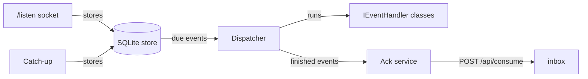

# Runner.Host

The connector. It receives inbox events by WebSocket push, stores them in a local SQLite file, runs the matching handlers and acks the events. Run one instance on each machine.

## Event flow



| Part | Behavior |
|---|---|
| Socket | Connects to `/listen?consumer=<name>`. Reconnects with exponential backoff and jitter. |
| Catch-up | Reads `pending=1&payload=1`. Runs at start, after each `hello`, and every 30 minutes. |
| Store | One row for each event `id`. A second copy of an `id` is ignored. |
| Dispatcher | Runs the matching handlers, oldest `id` first. |
| Ack service | Acks done and failed events. If the call fails, it tries again later. |

## Handler results

| Result | Connector action |
|---|---|
| Return | The handler is done. When all matching handlers are done, the event is acked. |
| Exception | Retry with backoff. After 5 attempts, the event is failed and acked. |
| `PermanentFailureException` | The event is failed and acked. No retry. |
| No matching handler | The event is acked. |

A retry runs only the handlers that are not done. A failed ack does not run the handlers again.

## Handler discovery

If `src/Runner.Handlers/Runner.Handlers.csproj` exists, `Runner.Host.csproj` references it and defines `RUNNER_HANDLERS`. `Program.cs` then does these steps:

1. Calls `services.AddHandlers(configuration)` from `Runner.Handlers`.
2. Scans the `Runner.Handlers` assembly for `IEventHandler` classes with `[On]`.

The dispatcher creates each handler in a DI scope. If the handler type is registered, the dispatcher uses that registration. If the project does not exist, the host runs without handlers and acks each event.

## Configuration

Section `Inbox` in `appsettings.json`:

| Key | Default | Meaning |
|---|---|---|
| `BaseUrl` | `https://inbox.mgcohen.workers.dev` | Inbox Worker URL |
| `Consumer` | Machine name | Must match `^[a-z0-9][a-z0-9_-]{0,63}$` |
| `Token` | None | Bearer token. Do not put it in `appsettings.json`. |
| `StorePath` | `runner-host.db` | SQLite file. Relative to the application folder. |
| `CatchUpInterval` | `00:30:00` | Time between two timer catch-ups |
| `MaxAttempts` | `5` | Handler attempts for one event |

If `Consumer` is empty, the connector uses the machine name in lowercase. It replaces each character that is not valid with `-`.

The token comes from one of these sources. The environment variable has priority.

- Environment variable `INBOX_TOKEN`.
- User secret `Inbox:Token`.

## Install on Windows (current user)

Run `deploy/install.ps1`. It needs no admin rights.

| Item | Value |
|---|---|
| Program | `%LOCALAPPDATA%\Runnerpp` |
| Start | Shortcut "Runner Host" in the Startup folder. It runs `run-runner.ps1` hidden at log-on. |
| Restart | `run-runner.ps1` starts the runner again 30 seconds after it stops |
| Settings | User environment variables: `INBOX_TOKEN` (required), `Inbox__StorePath`, `Claude__WorkingDirectory`, `NOTION_API_TOKEN`. The script reads them at each start. |
| Logs | `runner.log` (current run), `runner.old.log` (previous run), `runner.err.log` |
| Stop | Stop the `powershell.exe` that runs `run-runner.ps1`, then `Runner.Host.exe`. |

`Claude__WorkingDirectory` must be a folder that Claude Code trusts, or `claude --bg` refuses to start.

## Run

1. Go to `src/Runner.Host`.
2. Set the token: `dotnet user-secrets set Inbox:Token <token>`.
3. Start the connector: `dotnet run`.

If the token is missing or the consumer name is not valid, the connector stops at start with an error.

## Install as a Windows service

Run these steps in an administrator PowerShell.

1. Publish the connector:

   ```powershell
   dotnet publish src/Runner.Host -c Release -o C:\Services\Runner.Host
   ```

2. Create the service:

   ```powershell
   sc.exe create Runner.Host binPath= "C:\Services\Runner.Host\Runner.Host.exe" start= delayed-auto
   ```

3. Give the token to the service. The service account cannot read your user secrets.

   ```powershell
   Set-ItemProperty HKLM:\SYSTEM\CurrentControlSet\Services\Runner.Host -Name Environment -Type MultiString -Value "INBOX_TOKEN=<token>"
   ```

4. Start the service: `sc.exe start Runner.Host`.

The service writes `runner-host.db` in `C:\Services\Runner.Host`. The service writes warnings and errors to the Windows event log. To read them, open Event Viewer, **Windows Logs**, **Application**.

To remove the service: `sc.exe stop Runner.Host`, then `sc.exe delete Runner.Host`.

## Test

```bash
dotnet test
```

The tests use an in-process fake inbox with HTTP and WebSocket endpoints. They do not call the real inbox.
